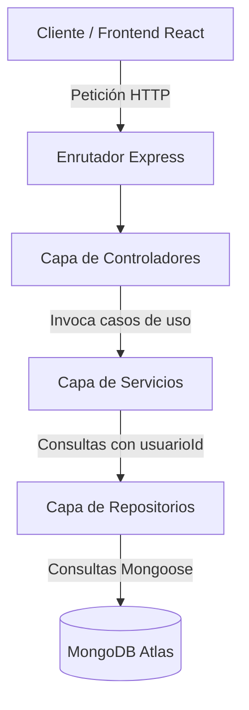

# AGENTS.md - Reglas y Directrices de Arquitectura para el Proyecto

Este documento establece las normas obligatorias de diseño, arquitectura, estilo y codificación para el desarrollo del **Dashboard de Finanzas Personales** (SaaS multiinquilino). Todos los agentes de desarrollo e ingenieros deben acatar estrictamente estas reglas sin excepción.

---

## 1. Visión y Alcance del Proyecto
- **Proyecto:** Dashboard de Finanzas Personales.
- **Tipo de Sistema:** Software como Servicio (SaaS) multiinquilino con aislamiento completo de datos por usuario/núcleo familiar.
- **Propósito:** Registrar, organizar, visualizar y analizar ingresos, gastos, presupuestos y medios de pago mediante una interfaz moderna, responsiva, amigable e interactiva.
- **Contexto de Evaluación:** Proyecto académico universitario diseñado para ser **simple pero completo**, limpio, robusto y fácil de defender y exponer en clase.

---

## 2. Stack Tecnológico Mandatorio

| Capa / Función | Tecnología / Librería | Versión / Enfoque |
|---|---|---|
| **Backend Runtime** | Node.js (LTS) | Modular con sintaxis ES Modules (`import`/`export`) |
| **Framework HTTP** | Express | Enrutamiento desacoplado y middlewares |
| **Base de Datos & ODM** | MongoDB Atlas con Mongoose | Modelado estricto, esquemas e índices |
| **Frontend SPA** | React 18+ con Vite | Componentes funcionales y Hooks |
| **Estilos CSS** | Tailwind CSS | Clases utilitarias, diseño responsivo y modo claro |
| **Visualización Gráfica**| Chart.js + react-chartjs-2 | Gráficos de barras, líneas y rosquilla/dona |
| **Manejo de Fechas** | Day.js | Fechas, filtros por rango, localización en español |
| **Alertas Modales** | SweetAlert2 | Diálogos de confirmación crítica (eliminar, alertas) |
| **Notificaciones Toast**| React-Toastify | Mensajes flotantes de éxito, error e información |
| **Exportación a Excel** | SheetJS (xlsx) | Generación de libros y hojas de cálculo financieras |
| **Exportación a PDF** | jsPDF + autotable | Reportes ejecutivos tabulados para impresión |
| **Validaciones de Datos**| Validator.js | Sanitización y validación estricta de entradas |
| **Identificadores Únicos**| uuid (v4) | Identificadores públicos de entidad |
| **Seguridad y JWT** | JSON Web Tokens + passport-jwt | Autenticación basada en token y control de acceso RBAC |

---

## 3. Reglas Cardinales de Desarrollo

### 3.1. Idioma: TODO en Español
- **100% en español:** Todos los nombres de rutas, endpoints, colecciones, modelos Mongoose, campos de bases de datos, variables, constantes, funciones, parámetros, clases, métodos, componentes React, props, estados, hooks, comentarios de código y mensajes de error deben estar redactados en idioma español formal.
- **Ejemplo correcto:** `const balanceEnCentavos = calcularBalance(ingresos, gastos);`
- **Ejemplo incorrecto:** `const balanceInCents = calculateBalance(incomes, expenses);`

### 3.2. Arquitectura de Software por Capas
Se exige implementar el patrón arquitectónico desacoplado en tres capas (**Controlador – Servicio – Repositorio**):

1. **Capa de Controladores (`controladores/`):**
   - Recibe la petición HTTP (`req, res, next`).
   - Extrae parámetros de la ruta, query params y cuerpo (`body`).
   - Delega la lógica de negocio a la capa de servicios.
   - Retorna las respuestas HTTP estandarizadas con sus códigos de estado correspondientes (200, 201, 400, 401, 403, 404, 500).
   - **Prohibido:** Contener lógica de negocio o consultas directas a Mongoose.

2. **Capa de Servicios (`servicios/`):**
   - Implementa las reglas de negocio, cálculos financieros y orquestación de operaciones.
   - Aplica validaciones de lógica de dominio (ej. verificar si una categoría existe antes de asociarla).
   - Valida políticas de autorización y permisos por rol.
   - **Prohibido:** Acceder directamente a objetos de solicitud/respuesta HTTP (`req`, `res`) o realizar consultas directas a la base de datos sin pasar por el repositorio.

3. **Capa de Repositorios (`repositorios/`):**
   - Encapsula todas las operaciones de acceso, lectura y persistencia en MongoDB Atlas a través de Mongoose.
   - **Aislamiento Multiinquilino Obligatorio:** Toda consulta (`find`, `findOne`, `create`, `updateOne`, `deleteOne`) debe incluir obligatoriamente el `usuarioId` verificado del token.
   - **Prohibido:** Implementar lógica de negocio o formato de presentación.

### 3.3. Manejo Financiero: Moneda Oficial Soles Peruanos (S/.) y Montos en Céntimos
- La moneda oficial del sistema es el **Sol Peruano (S/.)**, adaptado a la realidad financiera de Perú (bancos locales como BCP, BBVA, Interbank, billeteras digitales Yape/Plin y efectivo).
- Para evitar errores de redondeo causados por la aritmética de punto flotante de JavaScript (IEEE 754), **todos los montos financieros se almacenan y procesan en el backend como números enteros que representan céntimos (centavos de Sol)**.
  - Ejemplo: S/. 10.50 se almacena y calcula como `1050`.
  - Ejemplo: S/. 1,200.00 se almacena y calcula como `120000`.
- El frontend realiza la conversión a formato decimal exclusivamente para fines de visualización en la interfaz de usuario:
  - De céntimos a formato visible en Soles: `formatearCentavosAMoneda(centavos)` -> `"S/. 1,200.00"`
  - De entrada de usuario a céntimos enteros: `Math.round(parseFloat(valorIngresado) * 100)`
- **Regla Anti-Saldos Negativos (Saldo Insuficiente):** Queda estrictamente prohibido que cuentas de fondos directos (`efectivo`, `banco`, `billetera`) operen con saldo negativo. Todo gasto que supere los fondos disponibles debe ser rechazado en el backend con HTTP 400 Bad Request y bloqueado en el frontend con alertas preventivas.

### 3.4. Principios de Diseño: SOLID, KISS, DRY y YAGNI
- **KISS (Keep It Simple, Stupid):** Soluciones sencillas, legibles y comprensibles. El código debe poder ser explicado y defendido con total naturalidad ante el profesor y la clase.
- **DRY (Don't Repeat Yourself):** Reutilizar lógica mediante utilidades y middlewares comunes (ej. formateadores, middleware de autenticación, manejador centralizado de errores).
- **YAGNI (You Aren't Gonna Need It):** Implementar única y exclusivamente lo solicitado en los requerimientos. Nada de microservicios, brokers de mensajería (Kafka/RabbitMQ), websockets no solicitados o librerías pesadas no listadas.
- **SOLID:**
  - *S (Responsabilidad Única):* Cada archivo, controlador, servicio o componente cumple una única función clara.
  - *O (Abierto/Cerrado):* Módulos extensibles mediante middlewares y servicios independientes.
  - *D (Inversión de Dependencias):* Los controladores dependen de servicios y los servicios de repositorios.

### 3.5. Modelo de Seguridad y Multiinquilino (SaaS)
- **Aislamiento de Datos:** Cada usuario o inquilino solo puede consultar, modificar o eliminar sus propios recursos (`usuarioId`).
- **Autenticación con JWT:** Tokens firmados transmitidos en la cabecera `Authorization: Bearer <token>`.
- **RBAC (Role-Based Access Control):**
  - Rol `usuario`: Gestiona sus propias finanzas personales.
  - Rol `administrador`: Supervisa usuarios registrados y el estado general de la plataforma.
- **Criptografía:** Contraseñas protegidas mediante hash con `bcrypt` (mínimo 10 rondas de salt).
- **Manejo de Errores:** Respuestas de error homogéneas en español con estructura `{ estado, mensaje, errores? }` utilizando códigos HTTP estándar (400, 401, 403, 404, 409, 429, 500).
- **Especificaciones del Proyecto:** La carpeta [/specs](specs) contiene la especificación formal del sistema, modelo de datos, catálogo de rutas REST, escenarios Gherkin de HU-01 a HU-10 y reglas de negocio.

### 3.6. Estilo de Código y Documentación
- Código limpio, legible y modular.
- Comentarios breves y concisos en español encima de funciones clave explicando el "por qué" de la lógica para facilitar la exposición en clase.
- Uso consistente de async/await y bloques try/catch manejados centralizadamente.
- Estructura de carpetas limpia y coherente.

---

## 4. Estructura de Especificaciones del Proyecto (`/specs`)
Antes de generar código, el proyecto se encuentra formalmente documentado bajo el enfoque **Spec-Driven Development (SDD)** en los siguientes archivos dentro de `/specs`:
1. [historias.md](file:///specs/historias.md): Historias de usuario bajo formato INVEST con criterios de aceptación en Gherkin (4 escenarios por historia).
2. [api.md](file:///specs/api.md): Especificación detallada de endpoints REST, rutas, códigos de estado, parámetros y contratos de datos en español.
3. [modelo-datos.md](file:///specs/modelo-datos.md): Esquemas de Mongoose, campos en español, índices, relaciones y soporte multiinquilino con montos en centavos.
4. [reglas-negocio.md](file:///specs/reglas-negocio.md): Reglas de cálculo, validaciones con Validator.js, restricciones financieras y transaccionalidad.
5. [seguridad.md](file:///specs/seguridad.md): Flujos de autenticación JWT, recuperación de contraseña por correo, políticas RBAC y filtros de aislamiento en repositorio.
