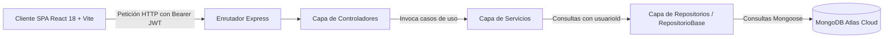

# Dashboard de Finanzas Personales 🇵🇪

> Aplicación web modular y responsiva para el registro, organización, análisis y visualización de finanzas personales en **Soles Peruanos (S/.)**, desarrollada bajo el stack **MERN** (MongoDB Atlas + Express + React 18 / Vite + Node.js) y arquitectura desacoplada en tres capas (**Controlador – Servicio – Repositorio**).

---

## 🌟 Características Principales

* 💰 **Moneda Oficial Soles Peruanos (S/.):** Contextualizado en el ecosistema bancario y comercial de Perú (BCP, Interbank, BBVA, billeteras digitales Yape / Plin y efectivo).
* 🛡️ **Regla Financiera Anti-Saldos Negativos:** Validación de solvencia que previene saldos negativos en cuentas de efectivo, débito y billeteras digitales, rechazando con HTTP 400 cualquier gasto que supere los fondos disponibles y advirtiendo en la interfaz en tiempo real.
* 🎯 **Presupuesto Mensual con Semáforo y Trazabilidad:** Monitoreo visual de gastos con semáforo preventivo (Verde `<80%`, Amarillo `80%-100%`, Rojo `>100%`), desglose analítico de las categorías que consumen el presupuesto y acceso directo al historial de movimientos del mes.
* 📊 **Dashboard Financiero Interactivo:** Tarjetas KPI de patrimonio total, ingresos, gastos, ahorro neto y gráficos con Chart.js (barras comparativas de ingresos vs gastos, dona por categoría y tendencia semestral).
* 📝 **Historial y Filtros Dinámicos:** Consulta cronológica paginada con filtros combinados por rango de fechas (validado con Day.js), categoría y tipo de transacción (`INGRESO` o `GASTO`).
* 📑 **Exportación Contable:** Descarga de reportes en Excel (`.xlsx` mediante SheetJS) y documentos ejecutivos en PDF estilizados (`.pdf` con jsPDF y autotable).
* 🔐 **Seguridad y Control de Acceso (RBAC):** Autenticación mediante tokens JWT firmados (vigencia de 1h), contraseñas con hash `bcrypt` (10 rondas de salt), recuperación por correo con token SHA-256 y control de acceso por roles (`ADMIN` y `USUARIO`).
* 🏢 **Arquitectura Multiinquilino (SaaS):** Aislamiento estricto de datos a nivel de repositorio forzando el filtro `{ usuarioId }` derivado del JWT, impidiendo vulnerabilidades de referencia directa a objetos (IDOR).

---

## 🏛️ Arquitectura del Sistema

El sistema implementa una arquitectura desacoplada en tres capas que respeta los principios **SOLID**, **KISS**, **DRY** y **Clean Code**:



### Componentes Clave de la Arquitectura
1. **Capa de Controladores (`server/src/controladores`):**
   * Recibe la petición HTTP (`req, res, next`), valida los parámetros de entrada y delega la ejecución al servicio correspondiente.
   * Retorna respuestas estandarizadas con códigos de estado HTTP semánticos (200, 201, 400, 401, 403, 404, 409).
2. **Capa de Servicios (`server/src/servicios`):**
   * Encapsula la lógica de dominio financiero: cálculo de balances, algoritmo de reversión matemática en edición/eliminación de movimientos, validación de saldo suficiente y políticas de autorización por rol.
3. **Capa de Repositorios (`server/src/repositorios`):**
   * A través de `RepositorioBase`, encapsula todas las operaciones de persistencia en MongoDB Atlas e inyecta obligatoriamente el `usuarioId` verificado del token en cada consulta (`find`, `findOne`, `create`, `updateOne`, `deleteOne`), garantizando el aislamiento total de datos entre usuarios.
4. **Aritmética Financiera Entera:**
   * Para evitar errores de precisión de punto flotante binario (IEEE 754), todos los montos se almacenan y calculan en el backend como números enteros que representan céntimos de Sol (`S/. 10.50` = `1050`). El frontend realiza la división entre 100 exclusivamente para su visualización formateada (`S/. 10.50`).

---

## 🛠️ Stack Tecnológico

| Capa / Función | Tecnologías Seleccionadas |
|---|---|
| **Backend Runtime** | Node.js (LTS) con sintaxis modular ES Modules (`import`/`export`) |
| **Framework HTTP** | Express 4.x con middlewares modulares |
| **Base de Datos & ODM** | MongoDB Atlas (Nube M0) con Mongoose |
| **Seguridad Backend** | Helmet, CORS, morgan, passport-jwt, jsonwebtoken |
| **Criptografía** | bcryptjs (hash de contraseñas) y crypto (tokens SHA-256) |
| **Validaciones** | Validator.js y Day.js |
| **Servicio de Correo** | Nodemailer (recuperación de contraseña) |
| **Frontend SPA** | React 18+, Vite, React Router DOM v6, Axios |
| **Estilos CSS** | Tailwind CSS (100% responsivo) |
| **Visualización Gráfica** | Chart.js + react-chartjs-2 |
| **Feedback de Usuario** | SweetAlert2 (confirmaciones modales) y React-Toastify (notificaciones) |
| **Exportación** | SheetJS (xlsx) y jsPDF + jspdf-autotable |

---

## ⚡ Guía de Inicio Rápido

### Requisitos Previos
* Node.js v18 o superior instalado.
* Conexión a internet (para conectar al clúster de MongoDB Atlas).

### Paso 1: Configurar Variables de Entorno
Copia el archivo `server/.env.example` como `server/.env` y define tu cadena de conexión a MongoDB Atlas:

```env
PUERTO=5000
NODE_ENV=development
MONGODB_URI=mongodb+srv://<usuario>:<password>@cluster0.znaegbi.mongodb.net/finanzas_personales?retryWrites=true&w=majority
CLIENT_URL=http://localhost:5173
JWT_SECRETO=clave_secreta_super_segura_finanzas_2026_jwt
JWT_EXPIRA=1h
CORREO_HOST=smtp.gmail.com
CORREO_PUERTO=587
CORREO_USUARIO=tu_correo@gmail.com
CORREO_CLAVE=tu_clave_de_aplicacion
```

### Paso 2: Ejecutar los Comandos de Arranque

#### Opción A: Iniciar Todo en un Solo Comando (Concurrente desde la raíz)
```bash
# 1. Instalar todas las dependencias en backend y frontend
npm run instalar

# 2. Poblar la base de datos en MongoDB Atlas (Seed de prueba)
npm run seed

# 3. Iniciar backend (5000) y frontend (5173) simultáneamente
npm run dev
```

#### Opción B: Iniciar Backend y Frontend por Separado (Dos Terminales)
* **Terminal 1 (Backend API):**
  ```bash
  cd server
  npm run dev
  # O desde la raíz: npm run dev:backend
  ```
* **Terminal 2 (Frontend React):**
  ```bash
  cd client
  npm run dev
  # O desde la raíz: npm run dev:frontend
  ```

---

## 🔑 Credenciales de Acceso para Pruebas

El comando `npm run seed` inserta usuarios de demostración, cuentas, categorías, presupuestos y más de 80 movimientos distribuidos en 6 meses:

| Rol | Correo Electrónico | Contraseña | Descripción / Propósito |
|---|---|---|---|
| **ADMIN** | `admin@demo.com` | `Admin123!` | Panel de administración y supervisión de usuarios `/admin/usuarios` con gestión de roles y accesos. |
| **USUARIO** | `usuario1@demo.com` | `Usuario123!` | Inquilino principal con transacciones realistas en Soles (BCP, Yape, Efectivo), presupuestos y gráficos históricos. |
| **USUARIO** | `usuario2@demo.com` | `Usuario123!` | Inquilino secundario para evidenciar el aislamiento multiinquilino (no visualiza los datos del Usuario 1). |

---

## 🌐 URLs del Sistema

* 💻 **Frontend Web (React + Vite):** [http://localhost:5173](http://localhost:5173)
* 📡 **Backend API REST (Express):** [http://localhost:5000](http://localhost:5000)
* 🩺 **Verificación de Salud de la API:** [http://localhost:5000/api/salud](http://localhost:5000/api/salud)

---

## 🛠️ Solución de Problemas Frecuentes con MongoDB Atlas

1. **Error de IP No Autorizada (`MongooseServerSelectionError / IP not whitelisted`):**
   * Ingresa a tu panel de [MongoDB Atlas](https://cloud.mongodb.com/).
   * En el menú lateral, dirígete a **Security → Network Access**.
   * Haz clic en **Add IP Address** y agrega tu IP actual o selecciona `0.0.0.0/0` (Allow Access from Anywhere) para pruebas de desarrollo.
2. **Error de Autenticación (`bad auth / Authentication failed`):**
   * Verifica que el usuario y la contraseña en la variable `MONGODB_URI` de `server/.env` sean correctos.
   * Si la contraseña contiene caracteres especiales como `@`, `:`, `#` o `/`, deben estar codificados en formato URL (URL-encoded).
3. **Error de Timeout DNS (`querySrv ETIMEOUT`):**
   * Si tu red institucional o router restringe consultas DNS SRV en el puerto 27017, puedes conectarte a la red compartida de tu móvil (Hotspot) o utilizar la cadena de conexión estándar de hosts directos que provee Atlas en la opción de drivers anteriores.
4. **Restaurar Datos de Demostración:**
   * El script `npm run seed` es **100% idempotente**. Puedes ejecutarlo en cualquier momento para restablecer las cuentas, categorías y movimientos con balances positivos y saludables.

---

## 📂 Estructura del Repositorio

```text
├── client/                     # Frontend SPA en React 18 + Vite + Tailwind CSS
│   ├── src/
│   │   ├── api/                # Cliente Axios con interceptor JWT
│   │   ├── componentes/        # Componentes modulares (layout, comunes, dashboard, movimientos)
│   │   ├── contexto/           # ContextoAuth para manejo global de sesión
│   │   ├── paginas/            # Vistas (Dashboard, Movimientos, Cuentas, Categorías, Presupuesto, Admin)
│   │   ├── rutas/              # Enrutador protegido por autenticación y por rol RBAC
│   │   └── utils/              # Formateadores en Soles (S/.) y exportadores a Excel y PDF
│   └── package.json
│
├── server/                     # Backend API REST en Node.js + Express + Mongoose
│   ├── scripts/                # Scripts de seed y verificación automatizada de historias
│   ├── src/
│   │   ├── config/             # Conexión a MongoDB Atlas, variables de entorno y Passport JWT
│   │   ├── controladores/      # Capa de Controladores HTTP
│   │   ├── modelos/            # Esquemas Mongoose (Usuario, Cuenta, Categoria, Movimiento, Presupuesto)
│   │   ├── politicas/          # Matriz de permisos RBAC
│   │   ├── repositorios/       # RepositorioBase con aislamiento multiinquilino
│   │   ├── rutas/              # Enrutadores Express desacoplados
│   │   ├── servicios/          # Capa de Servicios con reglas de negocio y anti-saldos negativos
│   │   ├── utils/              # Respuestas estandarizadas, hashing y fechas
│   │   └── validadores/        # Validadores de entrada con Validator.js
│   └── package.json
│
├── specs/                      # Especificaciones técnicas del proyecto (Spec-Driven Development)
│   ├── api.md                  # Catálogo formal de endpoints REST
│   ├── historias.md            # Historias de usuario bajo INVEST y sintaxis Gherkin
│   ├── modelo-datos.md         # Esquemas de persistencia y relaciones
│   ├── reglas-negocio.md       # Reglas contables, reversión y anti-saldos negativos
│   └── seguridad.md            # Políticas de autenticación JWT y roles RBAC
│
├── .gitignore                  # Exclusiones de Git (node_modules, .env, dist, guías internas)
├── AGENTS.md                   # Reglas de arquitectura y desarrollo
├── package.json                # Scripts de orquestación en la raíz
└── README.md                   # Documentación principal del proyecto
```

---

## 📑 Especificaciones del Proyecto (`/specs`)

El proyecto sigue una metodología formal de desarrollo guiado por especificaciones (**Spec-Driven Development**). Los contratos y criterios de aceptación se encuentran documentados en:

* [specs/historias.md](specs/historias.md): 10 Historias de Usuario con escenarios en sintaxis Gherkin (Camino Feliz, Alternativo, Error, Caso de Borde y Reglas de Solvencia).
* [specs/api.md](specs/api.md): Especificación exhaustiva de endpoints, parámetros, métodos y respuestas JSON.
* [specs/modelo-datos.md](specs/modelo-datos.md): Esquemas de persistencia en MongoDB Atlas con soporte multiinquilino.
* [specs/reglas-negocio.md](specs/reglas-negocio.md): Fórmulas contables, semáforo presupuestal y regla anti-saldos negativos.
* [specs/seguridad.md](specs/seguridad.md): Flujo de autenticación JWT, hashing bcrypt y matriz de autorización por roles.
