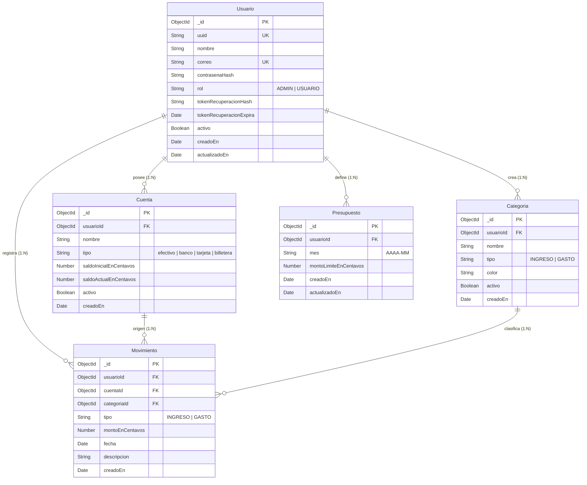

# Modelo de Datos y Esquemas Mongoose (MongoDB Atlas)

Este documento especifica los esquemas de persistencia en MongoDB Atlas para el **Dashboard de Finanzas Personales**.

---

## 1. Principios de Persistencia y Multiinquilino

1. **Aislamiento por `usuarioId`:** Todas las colecciones privadas de datos (`cuentas`, `categorias`, `movimientos`, `presupuestos`) contienen la referencia obligatoria indexada `usuarioId`.
2. **Moneda Oficial Soles (S/.) y Montos en Céntimos:** La moneda oficial es el Sol Peruano (`S/.`). Ningún saldo, monto o límite se almacena con decimales; se emplean números enteros positivos que representan céntimos de Sol (`montoEnCentavos`, `saldoInicialEnCentavos`, etc.).
3. **Identificadores Únicos:** Cada usuario cuenta con un `uuid` v4, y cada entidad de datos posee su `_id` de MongoDB para relaciones de consulta rápida.
4. **Fechas Automáticas:** Todos los esquemas incorporan `timestamps: { createdAt: 'creadoEn', updatedAt: 'actualizadoEn' }`.

---

## 2. Diagrama Entidad-Relación (Mermaid)

---

## 3. Especificación Detallada de Colecciones

### 3.1 Colección: `usuarios`
| Campo | Tipo | Restricción | Descripción |
|---|---|---|---|
| `_id` | `ObjectId` | PK | Identificador interno |
| `uuid` | `String` | Único, Indexado | Identificador público generado con `uuidv4()` |
| `nombre` | `String` | Requerido, Trim | Nombre completo (2-100 caracteres) |
| `correo` | `String` | Único, Minúsculas | Correo electrónico normalizado |
| `contrasenaHash` | `String` | Requerido, `select: false` | Contraseña hasheada con bcryptjs (10 rondas) |
| `rol` | `String` | Enum `['ADMIN', 'USUARIO']` | Rol RBAC (por defecto: `'USUARIO'`) |
| `tokenRecuperacionHash`| `String` | `select: false` | Hash SHA-256 de token de recuperación |
| `tokenRecuperacionExpira`| `Date` | `select: false` | Expiración a 30 minutos |
| `activo` | `Boolean` | Defecto `true` | Estado de la cuenta |
| `intentosFallidosLogin`| `Number` | Defecto `0` | Contador para límite de intentos |
| `bloqueadoHasta` | `Date` | Defecto `null` | Fecha límite de bloqueo temporal |

**Índices:** `{ correo: 1 }`, `{ uuid: 1 }`.

---

### 3.2 Colección: `cuentas`
| Campo | Tipo | Restricción | Descripción |
|---|---|---|---|
| `_id` | `ObjectId` | PK | Identificador interno |
| `usuarioId` | `ObjectId` | FK, Requerido | Vínculo multiinquilino al usuario |
| `nombre` | `String` | Requerido, Trim | Nombre descriptivo de la cuenta |
| `tipo` | `String` | Enum `['efectivo', 'banco', 'tarjeta', 'billetera']` | Tipo de medio de pago |
| `saldoInicialEnCentavos`| `Number` | Entero, Requerido | Saldo con el que se abrió la cuenta |
| `saldoActualEnCentavos`| `Number` | Entero, Requerido | Saldo vivo recalculado con cada movimiento |
| `activo` | `Boolean` | Defecto `true` | Borrado lógico si tiene transacciones |

**Índices:** `{ usuarioId: 1, activo: 1 }`.

---

### 3.3 Colección: `categorias`
| Campo | Tipo | Restricción | Descripción |
|---|---|---|---|
| `_id` | `ObjectId` | PK | Identificador interno |
| `usuarioId` | `ObjectId` | FK, Requerido | Vínculo multiinquilino al usuario |
| `nombre` | `String` | Requerido, Trim | Nombre de la categoría (ej. "Alimentación") |
| `tipo` | `String` | Enum `['INGRESO', 'GASTO']` | Tipo de movimiento que clasifica |
| `color` | `String` | Hexadecimal | Código de color para gráficos Chart.js |
| `activo` | `Boolean` | Defecto `true` | Estado activo |

**Índice Único Compuesto:** `{ usuarioId: 1, nombre: 1, tipo: 1 }` (Evita duplicados por usuario).

---

### 3.4 Colección: `movimientos`
| Campo | Tipo | Restricción | Descripción |
|---|---|---|---|
| `_id` | `ObjectId` | PK | Identificador interno |
| `usuarioId` | `ObjectId` | FK, Requerido | Vínculo multiinquilino al usuario |
| `cuentaId` | `ObjectId` | FK, Requerido | Cuenta bancaria de origen/destino |
| `categoriaId` | `ObjectId` | FK, Requerido | Categoría clasificadora |
| `tipo` | `String` | Enum `['INGRESO', 'GASTO']` | Tipo de movimiento (debe coincidir con categoría) |
| `montoEnCentavos` | `Number` | Entero positivo > 0 | Monto en céntimos de Sol (ej. 4550 = S/. 45.50) |
| `fecha` | `Date` | Requerido | Fecha de ocurrencia del movimiento |
| `descripcion` | `String` | Opcional, Trim | Nota descriptiva (máx 250 caracteres) |

**Índices:** `{ usuarioId: 1, fecha: -1 }`, `{ usuarioId: 1, categoriaId: 1 }`, `{ usuarioId: 1, cuentaId: 1 }`.

---

### 3.5 Colección: `presupuestos`
| Campo | Tipo | Restricción | Descripción |
|---|---|---|---|
| `_id` | `ObjectId` | PK | Identificador interno |
| `usuarioId` | `ObjectId` | FK, Requerido | Vínculo multiinquilino al usuario |
| `mes` | `String` | Formato `AAAA-MM` | Mes presupuestado (ej. "2026-11") |
| `montoLimiteEnCentavos`| `Number` | Entero positivo > 0 | Límite mensual global del usuario |

**Índice Único Compuesto:** `{ usuarioId: 1, mes: 1 }` (Garantiza un solo presupuesto global mensual por usuario, aplicando el principio KISS).
